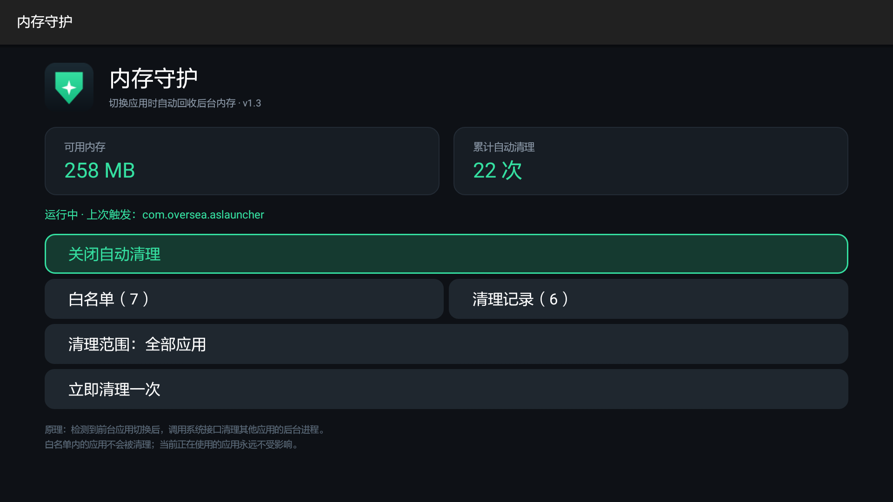
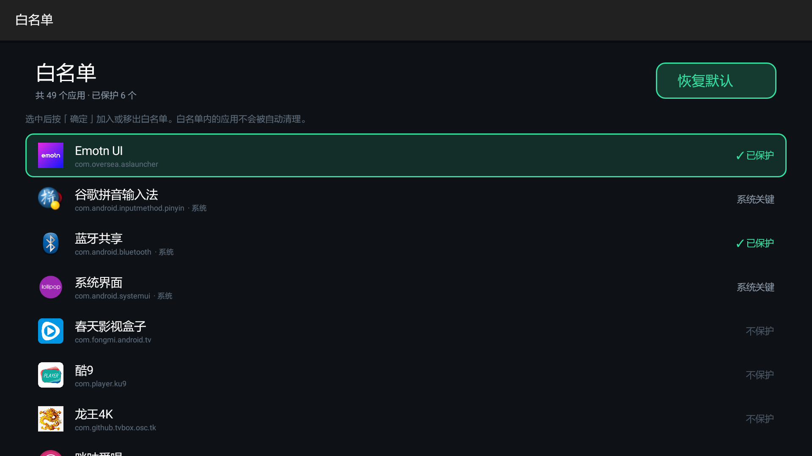
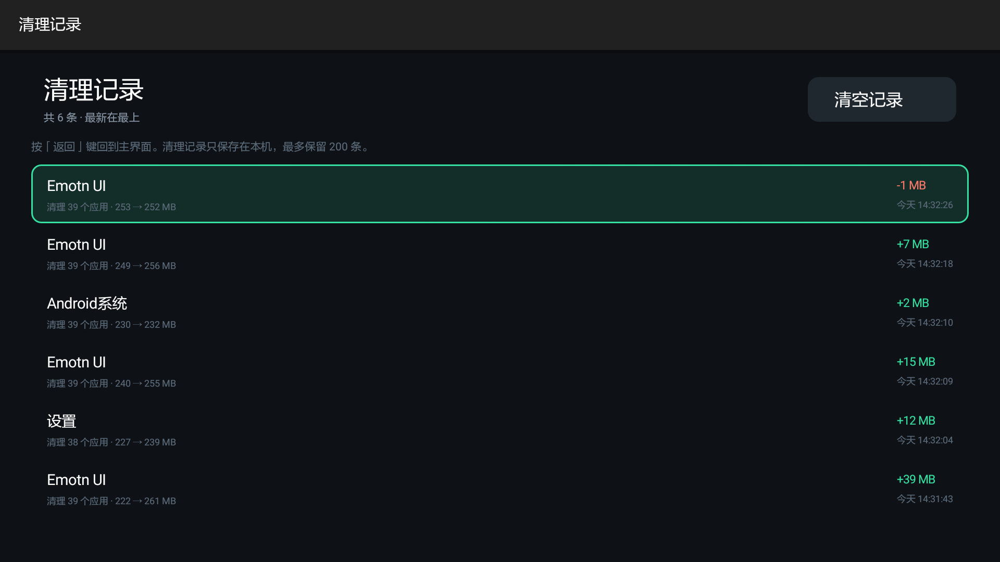
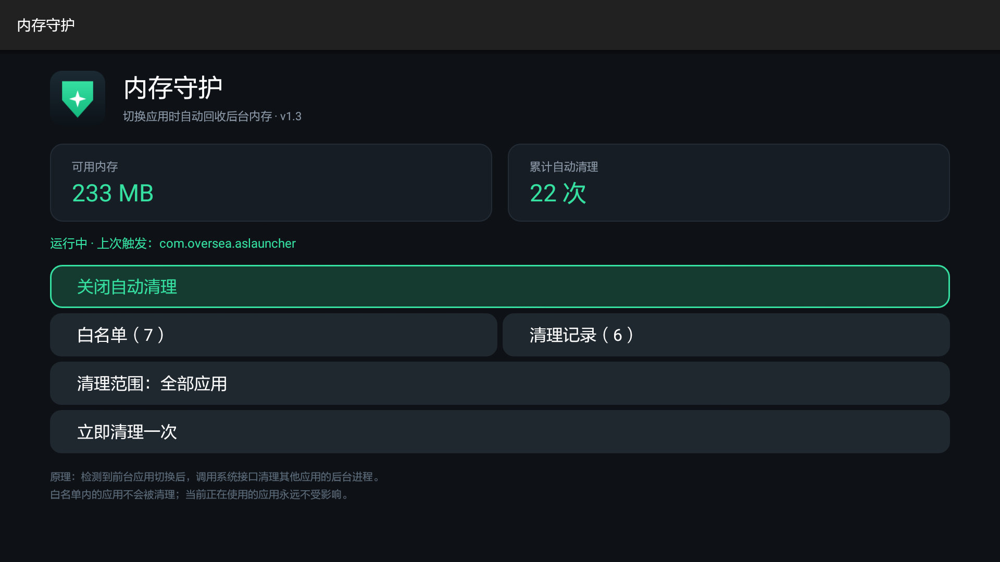
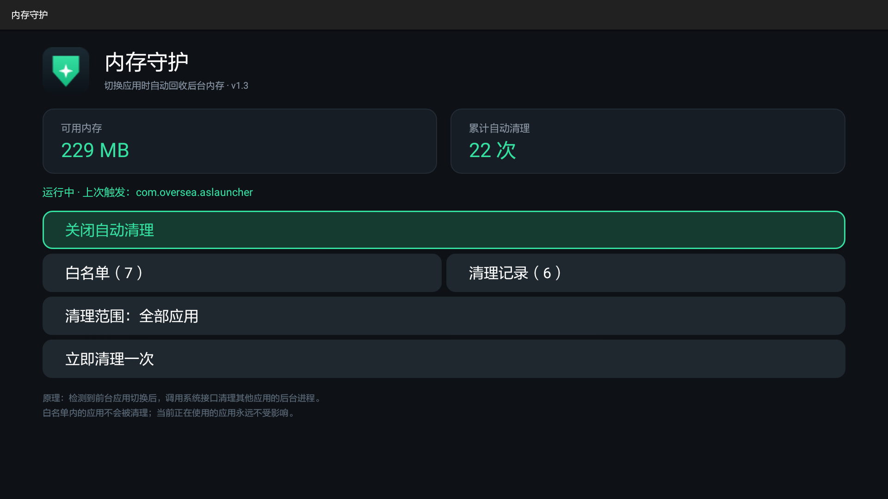

# 内存守护 · MemClean for Android TV


**给老电视盒子用的自动内存清理服务**：切换到新应用时，自动回收其他应用的后台进程。

为 1GB 内存的老盒子（如小米盒子3 / MDZ-16-AA、Amlogic S905）而写。不挑桌面，不依赖 root，不修改任何第三方应用。



---

## 目录

- [它解决什么问题](#它解决什么问题)
- [功能](#功能)
- [截图](#截图)
- [工作原理](#工作原理)
- [安装](#安装)
- [使用](#使用)
- [实测效果](#实测效果)
- [兼容性](#兼容性)
- [技术要点](#技术要点)
  - [多分辨率自适应](#多分辨率自适应)
  - [遥控器焦点必须手写](#遥控器焦点必须手写)
- [项目结构](#项目结构)
- [开发](#开发)
- [发布流程](#发布流程)
- [常见问题](#常见问题)
- [已知限制](#已知限制)
- [贡献](#贡献)
- [更新日志](#更新日志)
- [License](#license)

## 它解决什么问题

很多国产电视桌面的「自动清理内存」是桌面自己的功能——桌面被换掉、被禁用，功能就没了。

这个功能其实是刚需：1GB 内存的盒子，装着视频、音乐、投屏、应用市场七八个常驻后台的应用，
不清理就会越用越卡。但把它绑死在桌面上，等于把系统能力交给了一个可替换的应用。

本项目把这件事**从桌面里拿出来，做成独立常驻服务**：

- 换任何桌面都能用（当贝、Emotn、Quiet TV、原厂桌面……）
- 桌面进程被杀也不影响
- 不修改、不反编译任何第三方应用
- 只有一个 45 KB 的 APK，零第三方依赖

## 功能

| 功能 | 说明 |
| --- | --- |
| 自动清理 | 检测到前台应用切换时，清理其他应用的后台进程 |
| 手动清理 | 主界面「立即清理一次」按钮 |
| 白名单 | 逐个应用勾选保护，被保护的应用永远不会被清理 |
| 清理范围 | 全部应用 / 仅第三方应用（更保守，不动系统组件） |
| 系统关键组件锁定 | 系统界面、输入法强制保护，界面不可取消 |
| 清理记录 | 每次清理留一条：时间、触发应用、清理个数、内存前后变化 |
| 实时状态 | 可用内存、累计清理次数、上次触发来源，3 秒刷新 |
| 开机自启 | `BOOT_COMPLETED` 接收器 + 15 分钟看门狗 |
| 遥控器适配 | 显式焦点链，方向键移动、确定键触发、返回键退出 |
| 多分辨率自适应 | 三档尺寸资源，按 smallest-width 自动切换 |

## 截图

| 白名单管理 | 清理记录 |
| --- | --- |
|  |  |

三种典型电视配置下的自适应效果（内容比例一致，均无裁切）：

| 1280×720dp | 960×540dp | 1920×1080dp |
| --- | --- | --- |
|  |  |  |

## 工作原理

```
每 2 秒查询 UsageStats 的前台应用
        ↓
检测到前台应用变化（1.5 秒节流）
        ↓
遍历已安装应用，逐个调用 ActivityManager.killBackgroundProcesses()
        ↓
跳过：自身、当前前台应用、白名单、FLAG_PERSISTENT 系统常驻进程
        ↓
记录本次清理到历史
```

三个关键点：

1. **不用 root**。`killBackgroundProcesses()` 只需要 `KILL_BACKGROUND_PROCESSES` 普通权限。
2. **不用无障碍服务**。前台应用检测走 `UsageStatsManager.queryEvents()`，比无障碍更轻、更稳。
3. **不做整机轮询**。只读增量事件，2 秒一次，开销可忽略。

## 安装

### 方式一：下载 APK

从 Releases 页面下载最新 APK，用 U 盘或 `adb` 装到盒子上：

```bash
adb connect <盒子IP>:5555
adb install -r memclean-1.3.0.apk

# 授予「使用情况访问」权限（必须，否则检测不到应用切换）
adb shell appops set com.mibox3.memclean GET_USAGE_STATS allow

# 启动服务
adb shell am startservice -n com.mibox3.memclean/.MemCleanService
```

### 方式二：自行编译

见 [开发](#开发)。

### 用遥控器手动授权

不想用 adb 也可以：打开 App →「授予使用情况访问权限」→ 在系统设置里找到「内存守护」→ 打开。

> Android 5.1 的部分电视固件没有「使用情况访问」设置页，此时只能用 adb 授权。

## 使用

装好授权后无需任何操作，服务常驻后台。主界面能看到当前状态：

- **可用内存** — 实时读取 `ActivityManager.MemoryInfo`
- **累计自动清理** — 触发次数
- **状态行** — 绿色「运行中」/ 灰色「已暂停」/ 红色「缺权限」

五个入口：开关自动清理、白名单管理、清理记录、切换清理范围、立即清理一次。

**建议先观察一两天再调白名单。** 默认保护了桌面、系统界面、输入法、蓝牙、电话，
其他应用都会被清。如果你有后台常驻需求（比如后台放歌、后台下载），把它加进白名单。

## 实测效果

小米盒子3 / Android 5.1 / 1GB RAM / Emotn UI 桌面：

| 指标 | 清理前 | 清理后 |
| --- | --- | --- |
| MemAvailable | 217 MB | 317 MB |
| MemFree | 26 MB | 55 MB |
| 用户进程数 | 10 | 6 |

真机日志：

```
I/MemClean: foreground -> com.ktcp.video
I/MemClean: kill targets cached: 48
I/MemClean: cleaned 45 pkgs after switch to com.ktcp.video in 1240ms
I/MemClean: foreground -> com.oversea.aslauncher
I/MemClean: cleaned 46 pkgs after switch to com.oversea.aslauncher in 132ms
```

首次 1240ms 是冷的（系统调用路径未热、页缓存未命中），之后稳定在 **60~260ms**。

自身内存占用约 **21 MB PSS**（Native 2 MB + Dalvik 1.5 MB，其余为共享库），APK **45 KB**。

## 兼容性

| 项目 | 值 |
| --- | --- |
| minSdk | 21（Android 5.0） |
| targetSdk | 22 |
| 测试机型 | 小米盒子3 MDZ-16-AA，Android 5.1.1，Amlogic S905，1GB RAM |
| 测试桌面 | Emotn UI 1.0.8.7 |
| 第三方依赖 | 无 |

在 Android 8.0+ 上，后台服务受限，需要改为前台服务并申请 `FOREGROUND_SERVICE`。
本项目按 Android 5.x 设计，**未适配 8.0+**，但代码层面没有硬依赖，改造成本不大。

## 技术要点

### 多分辨率自适应

电视的 dp 尺寸差异比手机大得多。同样是 1080p 面板，系统密度报 240dpi 就是 **1280×720dp**，
报 320dpi 就只有 **960×540dp**；4K 面板报 320dpi 则是 **1920×1080dp**。写死一套 dp，换台电视就错位。

所以布局里没有一个写死的 dp/sp 数值，全部走资源限定符：

| 资源目录 | smallest width | 典型配置 | 设计基准 |
| --- | --- | --- | --- |
| `res/values/dimens.xml` | < 600dp | 1080p @320dpi（960×540dp） | 小档，约 0.76× |
| `res/values-sw600dp/dimens.xml` | ≥ 600dp | 1080p @240dpi（1280×720dp） | 基准档（实机校准） |
| `res/values-sw900dp/dimens.xml` | ≥ 900dp | 4K @320dpi（1920×1080dp） | 大档，约 1.45× |

字体用 `sp` 声明，但通过 `COMPLEX_UNIT_PX` 写入 `TextView`——因为 `getDimension()` 返回的
已经是按 `scaledDensity` 换算好的像素，再交给 `setTextSize(float)` 会被二次放大。

主界面外层是 `ScrollView`，极端情况（超大字体、超小屏幕）下内容溢出也不会被裁掉。

### 遥控器焦点必须手写

「白名单 / 清理记录」是左右分栏的两个按钮，曾经按下键时**整行被跳过**，焦点直接飞到下面的整宽按钮。

原因在 `FocusFinder` 的候选打分：

```
13 × 纵向距离² + 横向偏移²
```

从「关闭自动清理」按下键时：

| 候选 | 纵向距离 | 横向偏移 | 加权距离 |
| --- | --- | --- | --- |
| 白名单（左半，中心 x=525） | 11px | 435px | **190798** |
| 清理范围（整宽，中心 x=960） | 108px | 0 | **151632** ← 胜出 |

纵向差 10 倍，仍然输在横向偏移被平方放大。这是几何启发式的固有问题，不是布局写错了——
`uiautomator dump` 显示两个按钮都是 `focusable="true" clickable="true"`，只是焦点搜索没选它们。

所以本项目用 `setNextFocusUpId/DownId/LeftId/RightId` 写死了一条焦点链。
**电视布局里只要出现「整宽 + 分栏」混排，就必须自己指定焦点，不能指望自动搜索。**

## 项目结构

```
memclean/
├── AndroidManifest.xml            版本号与组件声明（版本号唯一来源）
├── build.sh                       无需 Gradle 的构建脚本
├── Makefile                       常用命令封装
├── CHANGELOG.md                   更新日志
├── CONTRIBUTING.md                贡献指南
├── LICENSE                        MIT
├── res/
│   ├── mipmap-*/ic_launcher.png   图标（由 tools/make_icon.py 生成）
│   ├── values/dimens.xml          尺寸资源 · 小档
│   ├── values-sw600dp/dimens.xml  尺寸资源 · 基准档
│   └── values-sw900dp/dimens.xml  尺寸资源 · 大档
├── src/com/mibox3/memclean/
│   ├── MemCleanService.java       前台监听 + 清理调度 + 看门狗
│   ├── Cleaner.java               包枚举、缓存、执行清理（服务与界面共用）
│   ├── BootReceiver.java          开机自启
│   ├── Prefs.java                 开关、模式、白名单、统计
│   ├── History.java               清理历史读写（行式纯文本，上限 200 条）
│   ├── Ui.java                    视觉规范：配色、圆角卡片、可聚焦按钮
│   ├── MainActivity.java          主界面
│   ├── WhitelistActivity.java     白名单管理
│   └── HistoryActivity.java       清理记录
├── tools/
│   ├── make_icon.py               图标生成器（纯 Python，无依赖）
│   ├── deploy.sh                  一键部署到盒子
│   └── verify_layouts.sh          三档密度截图验证
├── docs/
│   ├── shots/                     截图
│   └── releases/                  各版本发布说明（作为 Release 正文）
└── .github/
    ├── workflows/ci.yml           构建检查
    ├── workflows/release.yml      打标签自动发布
    └── ISSUE_TEMPLATE/            Issue / PR 模板
```

代码总量约 1600 行 Java，无第三方依赖。

## 开发

### 环境

只需要 **JDK 17** 和 **Android SDK（platform-34 + build-tools 34）**，不需要 Gradle、不需要 Android Studio。

> `d8` 从 build-tools 33 起要求 Java 11+，用 JDK 8 会在生成 dex 这一步报 `UnsupportedClassVersionError`。

```bash
# 下载 SDK（约 140MB，注意文件名不是想当然的那个）
curl -L -o platform34.zip https://dl.google.com/android/repository/platform-34-ext7_r03.zip
curl -L -o bt34.zip       https://dl.google.com/android/repository/build-tools_r34-macosx.zip
unzip -q platform34.zip -d sdk/platforms/
unzip -q bt34.zip       -d sdk/build-tools/
```

### 构建

```bash
make build
# 或直接用脚本
JAVA_HOME=/path/to/jdk17 ANDROID_SDK=$PWD/sdk ./build.sh
# → build/memclean-1.3.0.apk
```

`make` 需要系统有可用的 `make`：

- **Linux** — 自带，或用包管理器装 `build-essential` / `make`
- **macOS** — 需要 Xcode Command Line Tools：`xcode-select --install`
- **Windows** — 用 WSL，或直接跑 `build.sh`

签名默认用自动生成的调试证书。发布正式包时传入自己的 keystore：

```bash
KEYSTORE=release.jks KS_PASS=*** KEY_ALIAS=memclean KEY_PASS=*** ./build.sh
```

### 部署到设备

```bash
make deploy DEV=192.168.1.172:5555
# 等价于 ./tools/deploy.sh 192.168.1.172:5555
```

脚本会连接、推送、覆盖安装、授 `GET_USAGE_STATS`、拉起服务。
特意保留 `adb push` + `pm install` 的分步方式——直接 `adb install` 在这类老盒子上
会因流式传输超时被 SIGTERM。

### 验证多分辨率布局

```bash
make verify DEV=192.168.1.172:5555
```

依次把密度改成 240 / 320 / 160，对应 1280×720dp / 960×540dp / 1920×1080dp，
每档截图存到 `build/shots/`。退出时用 `trap` 强制 `wm density reset`，
中途 Ctrl-C 或报错也会还原。

### 改图标

```bash
make icon
# 或 python3 tools/make_icon.py
```

纯 Python 手写 PNG，不依赖 Pillow。

## 发布流程

发布完全由 GitHub Actions 驱动，本地只需要打标签。

### 1. 改版本号

版本号只在 `AndroidManifest.xml` 里维护，`build.sh` 与 CI 都会读它：

```xml
android:versionCode="10300"
android:versionName="1.3.0"
```

`versionCode` 用 `MMmmpp` 形式（`1.3.0` → `10300`），保证单调递增。

### 2. 更新文档

- `CHANGELOG.md` 加一条 `## [1.3.0] - YYYY-MM-DD`
- `docs/releases/v1.3.0.md` 写发布说明，**这个文件会直接作为 Release 正文**

### 3. 打标签推送

```bash
git commit -am "chore: release v1.3.0"
make tag          # 校验工作区干净、标签不重复，然后创建 v1.3.0
git push origin v1.3.0
```

### 4. 自动发布

推标签后 [`.github/workflows/release.yml`](.github/workflows/release.yml) 会：

1. 校验标签版本与 `AndroidManifest.xml` 的 `versionName` 一致，不一致直接失败
2. 用 `make build` 构建（与本地同一条路径）
3. 生成 `SHA256SUMS.txt`
4. 以 `docs/releases/<tag>.md` 为正文创建 Release，附上 APK 与校验和

带 `-` 的标签（如 `v1.4.0-beta1`）会自动标记为预发布。

普通 push 和 PR 走 [`ci.yml`](.github/workflows/ci.yml)，只构建并上传产物，不发版。

### 手动触发

在 Actions 页面选 `Release` → `Run workflow`，填入已存在的标签即可重跑。

> Release 里附的 APK 由 CI 用自动生成的调试证书签名。如果要固定签名，
> 把 keystore 转成 base64 存进 Secrets，在 workflow 里解码后传给 `KEYSTORE` 环境变量。

## 常见问题

**Q：装完没反应，状态行显示红色？**

没授予「使用情况访问」权限。用 `adb shell appops set com.mibox3.memclean GET_USAGE_STATS allow`，
或在系统设置里手动打开。

**Q：清理后应用重新打开变慢了？**

冷启动的正常代价。被清掉的应用下次打开要重新加载，这是用内存换速度的取舍。
有常驻需求的应用请加白名单。

**Q：后台放歌会被中断吗？**

会。`killBackgroundProcesses()` 是无差别的。把音乐应用加进白名单即可。

**Q：为什么回到桌面也会触发清理？**

这是刻意的。白名单的语义是「不被杀」，不是「不触发清理」——桌面本身在白名单里
（避免从应用返回时桌面要重新加载），但「回到桌面」恰恰是最该清理的时刻。
当前前台应用由 `Cleaner` 内部的 `pkg.equals(fg)` 单独保护，与白名单无关。

**Q：能清理系统应用吗？**

默认可以（「清理范围：全部应用」），但带 `FLAG_PERSISTENT` 的常驻进程一律跳过，
系统界面和输入法被强制锁定。想更保守就切到「仅第三方应用」。

**Q：服务会不会被杀？**

服务是 `START_STICKY`，还有 15 分钟的 `AlarmManager` 看门狗兜底。Android 5.x 上很稳。

## 已知限制

- **清理是无差别的**：后台下载、后台音乐播放会被中断。需要保留的应用请加白名单。
- 被清理的应用再次打开是冷启动，会慢一点。
- `killBackgroundProcesses()` 对持有前台服务的应用无效，这是系统行为，符合预期。
- Android 8.0+ 需要改为前台服务，本项目未适配。
- 清理记录只存本机，最多 200 条，没有导出功能。

## 贡献

欢迎提 Issue 和 PR，详见 [CONTRIBUTING.md](CONTRIBUTING.md)。

提 Bug 时请附上：盒子型号、Android 版本、`wm size` / `wm density` 输出、相关 `logcat`。
这些信息决定了问题能不能复现——电视盒子的固件差异比手机大得多。

## 更新日志

见 [CHANGELOG.md](CHANGELOG.md)。

## License

[MIT](LICENSE)
